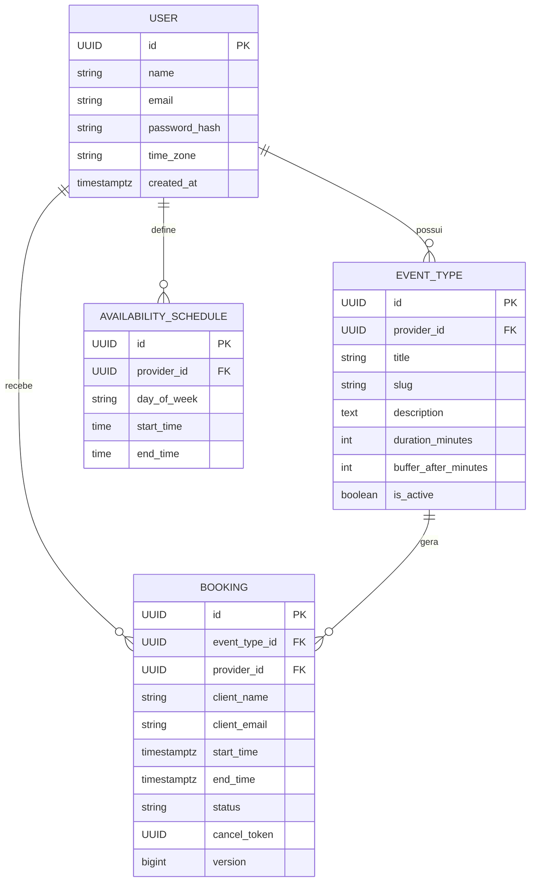

# Especificação de Requisitos de Software (SRS)

## Sistema de Agendamento Inteligente com Prevenção de Conflitos

> Documento de Arquitetura e Engenharia de Requisitos • **Versão 1.0**

---

## Sumário

1. [Visão Geral do Projeto](#1-visão-geral-do-projeto)
2. [Perfis de Usuário (Atores)](#2-perfis-de-usuário-atores)
3. [Requisitos Funcionais (RF)](#3-requisitos-funcionais-rf)
4. [Requisitos Não Funcionais (RNF)](#4-requisitos-não-funcionais-rnf)
5. [Modelo Conceitual de Dados](#5-modelo-conceitual-de-dados)
6. [Stack Tecnológica Recomendada](#6-stack-tecnológica-recomendada)
7. [Arquitetura de Interface e Especificação de Telas](#7-arquitetura-de-interface-e-especificação-de-telas)
8. [Especificação Completa dos Endpoints da API REST](#8-especificação-completa-dos-endpoints-da-api-rest)

---

## 1. Visão Geral do Projeto

O **Sistema de Agendamento Inteligente** é uma plataforma distribuída destinada ao gerenciamento automatizado de disponibilidade, fusos horários e reservas de horários entre prestadores de serviços e seus respectivos clientes.

O objetivo central da arquitetura é fornecer uma solução com **alta confiabilidade**, **consistência transacional estrita** e **prevenção absoluta de sobreposições de horários (double booking)**, mesmo sob condições de altíssima concorrência simultânea. O sistema resolve a complexidade de alocação temporal e conversões de fuso horário (*timezones*), garantindo uma experiência fluida para ambas as pontas da plataforma.

---

## 2. Perfis de Usuário (Atores)

| Ator | Descrição | Permissões e Responsabilidades |
|------|-----------|--------------------------------|
| **Prestador de Serviço** | Usuário autenticado proprietário da agenda. | Autentica-se na plataforma, gerencia tipos de eventos, define durações, tempos de respiro (*buffers*), configura a grade de disponibilidade semanal e estabelece bloqueios pontuais de agenda. |
| **Cliente** | Usuário final (não autenticado ou visitante). | Acessa a página pública do prestador via link/slug, visualiza a disponibilidade convertida para seu fuso horário local e realiza agendamentos fornecendo dados de contato. |

---

## 3. Requisitos Funcionais (RF)

### RF01 - Autenticação e Controle de Acesso (RBAC)

- **Descrição:** O sistema deve fornecer controle de acesso seguro para os prestadores de serviço.
- **Detalhes de Implementação:**
  - Implementação de **Spring Security** com suporte a *stateless tokens* **JSON Web Tokens (JWT)**.
  - Emissão de **Access Token** (curta duração) e **Refresh Token** (persistido de forma segura com rotação de chaves).
  - Senhas devem ser submetidas a *hashing* forte antes da persistência.

### RF02 - Gestão de Tipos de Eventos (Event Types)

- **Descrição:** Permitir que o prestador configure múltiplos modelos de atendimento personalizáveis.
- **Campos Obrigatórios:** Título, slug exclusivo (utilizado na URL pública), descrição, duração (em minutos) e tempo de respiro pós-atendimento (`buffer_after`, em minutos).
- **Regra de Negócio:** O tempo de respiro reserva automaticamente um intervalo bloqueado logo após o término do evento para evitar atendimentos em sequência sem pausa.

### RF03 - Grade de Disponibilidade Semanal

- **Descrição:** Permite ao prestador definir sua jornada de trabalho recorrente para cada dia da semana.
- **Detalhes de Implementação:**
  - Configuração de múltiplos blocos operacionais por dia (ex.: Segunda-feira das 08:00 às 12:00 e das 13:00 às 17:00).
  - Associação direta com o fuso horário de referência do prestador (`ZoneId` IANA, ex.: `America/Sao_Paulo`).

### RF04 - Bloqueios Pontuais e Exceções

- **Descrição:** Permitir a inclusão de exceções à regra de disponibilidade semanal.
- **Regra de Negócio:** Cadastro de intervalos específicos de ausência (férias, feriados, compromissos pessoais ou bloqueios *ad-hoc*). Qualquer horário compreendido dentro de um bloqueio pontual deve ser sumariamente desconsiderado no cálculo de slots livres.

### RF05 - Cálculo Dinâmico de Slots Livres

- **Descrição:** Endpoint público para consulta de horários disponíveis em um intervalo de datas solicitado pelo cliente.
- **Algoritmo de Cálculo:**
  1. Recupera a grade semanal do prestador no fuso horário local e mapeia para a data solicitada.
  2. Subtrai os agendamentos já confirmados (*Booking*) acrescidos dos seus respectivos tempos de *buffer*.
  3. Subtrai as exceções e bloqueios pontuais cadastrados.
  4. Fatia os intervalos restantes em blocos de tamanho correspondente à duração do evento solicitado.

### RF06 - Conversão Automática de Fuso Horário

- **Descrição:** Tratar diferenças geográficas de fuso horário de maneira transparente.
- **Regra de Negócio:**
  - Todo o processamento interno da aplicação e a persistência em banco de dados ocorrem rigorosamente normalizados em **UTC**.
  - A API recebe e devolve *timestamp* UTC, permitindo que a interface *frontend* converta e exiba a grade nos horários locais do cliente e do prestador.

### RF07 - Reserva com Prevenção Absoluta de Duplicidade

- **Descrição:** Processamento de reservas com controle rigoroso de concorrência.
- **Regra de Negócio:** Em caso de requisições simultâneas para o mesmo slot de horário, a camada de persistência deve garantir que **apenas uma transação seja concluída com sucesso**, rejeitando imediatamente as demais com um erro amigável de conflito (`409 Conflict`).

### RF08 - Cancelamento e Reagendamento

- **Descrição:** Fluxo de cancelamento simplificado sem necessidade de login por parte do cliente.
- **Detalhes de Implementação:**
  - O e-mail de confirmação deve conter um link de cancelamento/reagendamento munido de um **token opaco (UUID)**.
  - Ao confirmar o cancelamento, o status do agendamento é alterado para `CANCELED`, liberando instantaneamente o slot temporal no motor de busca.

### RF09 - Geração de Convite iCalendar (.ics)

- **Descrição:** Integração nativa com gerenciadores de agenda pessoais.
- **Detalhes de Implementação:**
  - A confirmação de agendamento dispara a criação de um arquivo padrão iCalendar (`.ics`) contendo UID único, metadados do evento, status `CONFIRMED` e horários formatados.
  - O arquivo deve ir anexado diretamente no e-mail transacional do cliente e do prestador.

### RF10 - Notificações Assíncronas

- **Descrição:** Envio de e-mails transacionais sem afetar o tempo de resposta da API de agendamento.
- **Detalhes de Implementação:**
  - Disparo de mensagens (Confirmação, Lembrete prévio e Cancelamento) processado de forma desconectada da *thread* principal da requisição via mensageria/filas em *background*.

---

## 4. Requisitos Não Funcionais (RNF)

| Código | Categoria | Descrição / Especificação Técnica |
|--------|-----------|-----------------------------------|
| **RNF01** | Concorrência & Isolamento | O sistema deve aplicar isolamento transacional rigoroso utilizando *Pessimistic/Optimistic Locking* no JPA, combinado com *constraint* de exclusão em nível de banco de dados no PostgreSQL via extensão `btree_gist` e tipo `tstzrange`. |
| **RNF02** | Padronização Temporal | Toda a camada de modelo de dados deve utilizar `java.time.Instant` / `TIMESTAMP WITH TIME ZONE`. O sistema **proíbe** o uso de datas ingênuas (*naive timestamps*) sem informação explícita de *offset*. |
| **RNF03** | Desempenho & Cache | A rota de cálculo dinâmico de slots livres deve responder em **menos de 200 ms (p95)**. Deve ser utilizado **Redis** para *caching* da disponibilidade base e configurações do prestador. |
| **RNF04** | Qualidade & Testes | Cobertura de testes unitários para o motor de busca de slots e validação de sobreposições com **JUnit 5** e **Mockito**. Validação de concorrência real e *race conditions* via testes de integração com **Testcontainers** e PostgreSQL real. |
| **RNF05** | Segurança | Criptografia de senhas com algoritmo **BCrypt** (*cost factor* mínimo 12). Validação de inputs no backend via Bean Validation (`jakarta.validation`) e no frontend via **Zod**. Configuração estrita de políticas de **CORS** e proteção contra **CSRF**. |

---

## 5. Modelo Conceitual de Dados

### 5.1. Entidades e Relacionamentos



<details>
<summary>Versão em diagrama ASCII</summary>

```text
+------------------+         +-----------------------+
| User (Provider)  | 1     N |      EventType        |
+------------------+---------+-----------------------+
| id (UUID) [PK]   |         | id (UUID) [PK]        |
| name             |         | provider_id (UUID)[FK]|
| email            |         | title                 |
| password_hash    |         | slug                  |
| time_zone        |         | duration_minutes      |
| created_at       |         | buffer_after_minutes  |
+------------------+         | is_active             |
        | 1                  +-----------------------+
        |                              | 1
        | N                            |
+-----------------------+              | N
| AvailabilitySchedule  |      +-----------------------+
+-----------------------+      |       Booking         |
| id (UUID) [PK]        |      +-----------------------+
| provider_id (UUID)[FK]|      | id (UUID) [PK]        |
| day_of_week           |      | event_type_id(UUID)[FK|
| start_time            |      | provider_id (UUID)[FK]|
| end_time              |      | client_name           |
+-----------------------+      | client_email         |
                               | start_time (UTC)      |
                               | end_time (UTC)        |
                               | status                |
                               | cancel_token (UUID)   |
                               | version (Long)        |
                               +-----------------------+
```

</details>

### 5.2. Detalhamento das Tabelas

#### User (Provider)

| Campo | Tipo | Descrição |
|-------|------|-----------|
| `id` | UUID (PK) | Identificador único |
| `name` | VARCHAR(255) | Nome do prestador |
| `email` | VARCHAR(255) | E-mail único para login |
| `password_hash` | VARCHAR(255) | Senha criptografada com BCrypt |
| `time_zone` | VARCHAR(50) | Identificador de fuso IANA (ex.: `"America/Sao_Paulo"`) |
| `created_at` | TIMESTAMP WITH TIME ZONE | Data de criação da conta |

#### EventType

| Campo | Tipo | Descrição |
|-------|------|-----------|
| `id` | UUID (PK) | Identificador único |
| `provider_id` | UUID (FK → `User.id`) | Prestador proprietário |
| `title` | VARCHAR(100) | Título da reunião (ex.: "Consultoria Técnica") |
| `slug` | VARCHAR(100) | Identificador amigável para URL pública |
| `description` | TEXT | Detalhes do evento |
| `duration_minutes` | INTEGER | Duração da sessão em minutos |
| `buffer_after_minutes` | INTEGER | Tempo de intervalo necessário após a sessão |
| `is_active` | BOOLEAN | Status de ativação do evento |

#### AvailabilitySchedule

| Campo | Tipo | Descrição |
|-------|------|-----------|
| `id` | UUID (PK) | Identificador único |
| `provider_id` | UUID (FK → `User.id`) | Prestador proprietário |
| `day_of_week` | VARCHAR(10) | Dia da semana (`MONDAY`, `TUESDAY`, etc.) |
| `start_time` | TIME | Horário de início do turno local |
| `end_time` | TIME | Horário de término do turno local |

#### Booking

| Campo | Tipo | Descrição |
|-------|------|-----------|
| `id` | UUID (PK) | Identificador único |
| `event_type_id` | UUID (FK → `EventType.id`) | Tipo de evento reservado |
| `provider_id` | UUID (FK → `User.id`) | Prestador |
| `client_name` | VARCHAR(255) | Nome completo do cliente |
| `client_email` | VARCHAR(255) | E-mail do cliente |
| `start_time` | TIMESTAMP WITH TIME ZONE (UTC) | Início da reunião |
| `end_time` | TIMESTAMP WITH TIME ZONE (UTC) | Fim da reunião |
| `status` | VARCHAR(20) | Estado da reserva (`CONFIRMED`, `CANCELED`) |
| `cancel_token` | UUID | Token seguro para gerenciamento da reserva pelo cliente |
| `version` | BIGINT | Campo de controle para *Optimistic Locking* (`@Version`) |

---

## 6. Stack Tecnológica Recomendada

### Backend Architecture

| Camada | Tecnologia |
|--------|------------|
| Linguagem & Framework | Java 21 LTS + Spring Boot 3.x |
| Segurança | Spring Security + JWT (JSON Web Tokens) |
| Persistência de Dados | Spring Data JPA / Hibernate + PostgreSQL 16 |
| Prevenção de Conflitos | PostgreSQL Exclusion Constraints (`tstzrange` + `btree_gist`) |
| Migrações | Flyway Migration |
| Cache & Performance | Redis + Spring Cache |
| Qualidade & Testes | JUnit 5, Mockito, AssertJ, Testcontainers (PostgreSQL e Redis) |

### Frontend Architecture

| Camada | Tecnologia |
|--------|------------|
| Core Framework | React 18 + TypeScript + Vite |
| Estilização & UI | Tailwind CSS + Radix UI / Shadcn UI |
| Estado & Data Fetching | TanStack Query (React Query v5) |
| Formulários & Validação | React Hook Form + Zod |
| Datas e Timezones | date-fns / date-fns-tz ou dayjs (com plugin `utc` e `timezone`) |

---

## 7. Arquitetura de Interface e Especificação de Telas

Detalhadas por perfil de acesso (Área do Prestador e Área Pública do Cliente), contendo a estrutura de layout, componentes, comportamento de UX e fluxo de interação para cada tela.

### 7.1. Área Autenticada (Prestador de Serviço)

1. Tela de Login e Cadastro (Auth)
2. Dashboard Principal / Meus Agendamentos
3. Gestão de Tipos de Eventos (Event Types)
4. Configuração de Disponibilidade e Bloqueios (Schedule Settings)

### 7.2. Área Pública (Cliente / Convidado)

5. Página Pública de Agendamento (fluxo multietapas estilo Calendly):
   - **Etapa 1:** Seleção de Data e Fuso Horário
   - **Etapa 2:** Seleção de Slot de Horário
   - **Etapa 3:** Formulário de Confirmação e Dados Pessoais
6. Tela de Confirmação e Sucesso (*Booking Confirmed*)
7. Tela de Gestão da Reserva / Cancelamento (via Token UUID)

---

## 8. Especificação Completa dos Endpoints da API REST

Documentação técnica dos endpoints do sistema desenvolvidos em Spring Boot, divididos em módulos claros.

### 8.1. Módulo de Autenticação & Usuários (`/api/v1/auth`)

| Método | Endpoint | Descrição |
|--------|----------|-----------|
| `POST` | `/api/v1/auth/register` | Cadastro de novo prestador. |
| `POST` | `/api/v1/auth/login` | Autenticação do prestador retornando Access Token (JWT) e Refresh Token. |
| `POST` | `/api/v1/auth/refresh` | Renovação de tokens expirados. |
| `POST` | `/api/v1/auth/logout` | Invalidação do token atual (inserção na *blacklist* do Redis). |

### 8.2. Módulo de Tipos de Eventos - Prestador (`/api/v1/event-types`)

> 🔒 **Requer JWT**

| Método | Endpoint | Descrição |
|--------|----------|-----------|
| `GET` | `/api/v1/event-types` | Lista todos os tipos de eventos configurados pelo prestador logado. |
| `POST` | `/api/v1/event-types` | Cria um novo tipo de evento (título, slug, duração em minutos, buffer em minutos, descrição). |
| `PUT` | `/api/v1/event-types/{id}` | Atualiza configurações do evento (invalida cache no Redis). |
| `PATCH` | `/api/v1/event-types/{id}/toggle-status` | Ativa ou desativa o evento. |
| `DELETE` | `/api/v1/event-types/{id}` | Remove ou arquiva um tipo de evento. |

### 8.3. Módulo de Disponibilidade & Bloqueios - Prestador (`/api/v1/schedules`)

> 🔒 **Requer JWT**

| Método | Endpoint | Descrição |
|--------|----------|-----------|
| `GET` | `/api/v1/schedules` | Consulta a grade semanal recorrente do prestador e seu fuso horário (`ZoneId`). |
| `PUT` | `/api/v1/schedules` | Atualiza a grade semanal (invalida cache no Redis). |
| `GET` | `/api/v1/schedules/overrides` | Lista exceções e bloqueios pontuais futuros. |
| `POST` | `/api/v1/schedules/overrides` | Adiciona novo bloqueio pontual (data/hora início e fim). |
| `DELETE` | `/api/v1/schedules/overrides/{id}` | Remove um bloqueio pontual. |

### 8.4. Módulo de Gestão de Agendamentos - Prestador (`/api/v1/provider/bookings`)

> 🔒 **Requer JWT**

| Método | Endpoint | Descrição |
|--------|----------|-----------|
| `GET` | `/api/v1/provider/bookings` | Lista agendamentos do prestador com filtros (status, data início/fim, paginação). |
| `GET` | `/api/v1/provider/bookings/{id}` | Detalhes completos de um agendamento específico. |
| `POST` | `/api/v1/provider/bookings/{id}/cancel` | Cancelamento de agendamento pelo prestador com justificativa. |

### 8.5. Módulo Público de Agendamento do Cliente (`/api/v1/public`)

> 🌐 **Acesso aberto / Rate limited**

| Método | Endpoint | Descrição |
|--------|----------|-----------|
| `GET` | `/api/v1/public/users/{userSlug}/events/{eventSlug}` | Metadados públicos do evento e do prestador (nome, duração, descrição). |
| `GET` | `/api/v1/public/events/{eventSlug}/available-days` | Retorna lista de datas disponíveis no mês para o calendário (requer *timezone* do cliente). |
| `GET` | `/api/v1/public/events/{eventSlug}/slots` | Retorna horários livres para uma data específica (requer `date` no formato `YYYY-MM-DD` e *timezone* do cliente; processado com cache Redis). |
| `POST` | `/api/v1/public/events/{eventSlug}/hold-slot` | *(Opcional)* Cria uma trava temporária de 5 min no Redis para o slot selecionado. |
| `POST` | `/api/v1/public/events/{eventSlug}/book` | Cria o agendamento com controle de concorrência estrito (PostgreSQL *exclusion constraint*). Retorna `201 Created` com dados da reserva e o `cancel_token`, ou `409 Conflict` em caso de duplicidade. |

### 8.6. Módulo do Convidado / Gerenciamento de Agendamentos (`/api/v1/guest`)

> 🌐 **Sem login obrigatório**

| Método | Endpoint | Descrição |
|--------|----------|-----------|
| `GET` | `/api/v1/guest/bookings/{cancelToken}` | Consulta detalhes do agendamento específico via token opaco. |
| `POST` | `/api/v1/guest/bookings/{cancelToken}/cancel` | Cancela o agendamento via token seguro, liberando o slot e disparando notificação assíncrona. |
| `POST` | `/api/v1/guest/magic-link/request` | Solicita envio de e-mail com link temporário para consultar todos os agendamentos vinculados a um e-mail (token armazenado no Redis com TTL de 15 min). |
| `GET` | `/api/v1/guest/magic-link/verify` | Valida o token temporário do Magic Link e retorna a lista de agendamentos associados ao e-mail informado. |
